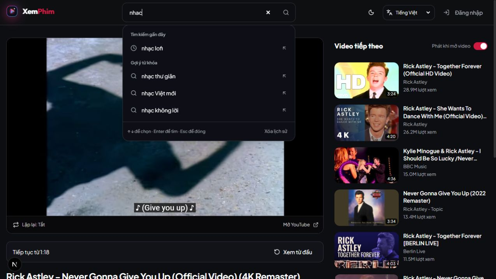
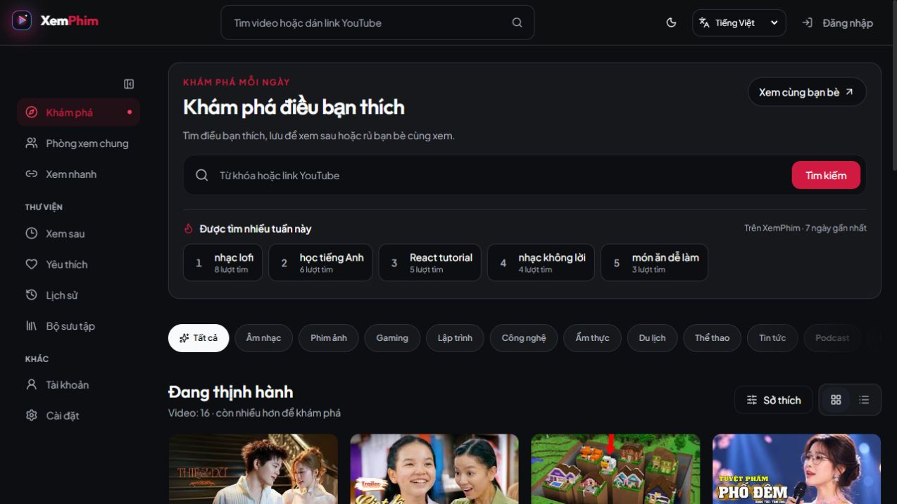
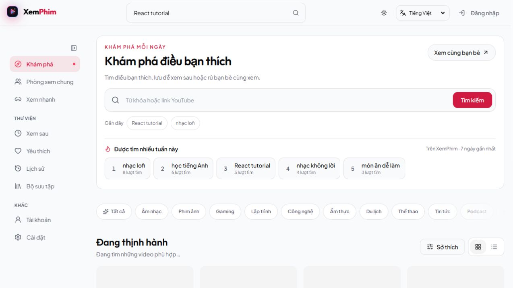
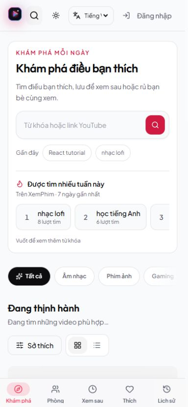

# Keyword suggestions

The home search and header search share one accessible autocomplete. It now combines matching recent searches, real weekly popular keywords from XemPhim, and an editorial keyword catalog in Vietnamese, English and Telugu. Typing filters the loaded list locally without an API call; submitting uses the existing video search and records a separate best-effort analytics event. The editorial catalog is labelled separately from measured popularity.

Recent searches keep their existing browser storage format. Matching ignores Vietnamese accents and casing, preserves Telugu vowel signs, removes duplicate phrases, and hides suggestions for video IDs and links. Results are limited to six rows, with discovery keywords still visible when the empty input has a full search history.

## Verification

- `npm run typecheck` and `npm run lint` passed.
- `npm run build` passed with placeholder credentials and an isolated local database URL; no production data was used.
- `node --import tsx --test lib/*.test.ts` passed all 82 tests, including suggestions, analytics validation, cache behavior and the recording queue.
- Browser checks covered home and header searches, pointer selection, arrow keys and Enter, Escape retaining input focus, mobile Escape returning to the search trigger, recent searches shared between the two fields, Vietnamese accent matching, English and Telugu suggestions, and opening a pasted YouTube URL.
- Visually checked the desktop layout, mobile layout at 390 × 844, and light/dark themes. No horizontal overflow at the mobile size.
- Physical-device touch input, native IME conversion and screen-reader speech were not tested. Composition events are guarded in both search fields.

## Weekly popularity extension

- `SEARCH_ANALYTICS_INTEGRATION=1 node --import tsx --test integration/search-analytics.test.ts` passed all nine checks against isolated PostgreSQL 18 with a non-UTC database timezone (`Asia/Bangkok`). Coverage includes independent exact seven-day boundaries, future exclusion, Top 10 cutoff, locale separation, concurrent deduplication, per-visitor limits, retention, HTTP validation, cookie identity and database outages.
- `ROOM_HTTP_INTEGRATION=1 node --import tsx --test integration/room-http.test.ts` passed.
- The additive schema script passed repeated and simultaneous runs against the isolated database.
- Browser verification covered Vietnamese and English ranked data, Telugu's genuine empty state, light/dark desktop and 390 × 844 mobile layouts, popular keywords in the autocomplete, keyboard selection and clicking the current topic after editing a draft. Mobile document width remained within the viewport.
- Actual browser submissions were checked in PostgreSQL: two rapid submissions of the same keyword produced one event. Header search recorded its own keyword too. The local loopback origin is covered by a regression test.
- The screenshots below use disposable **local QA events**, never production data. Those events were removed after verification. Production rankings start collecting on deployment and require two anonymous browser identifiers per keyword; cached rankings can lag changes by a few minutes. See [counting rules](../search-analytics.md).

